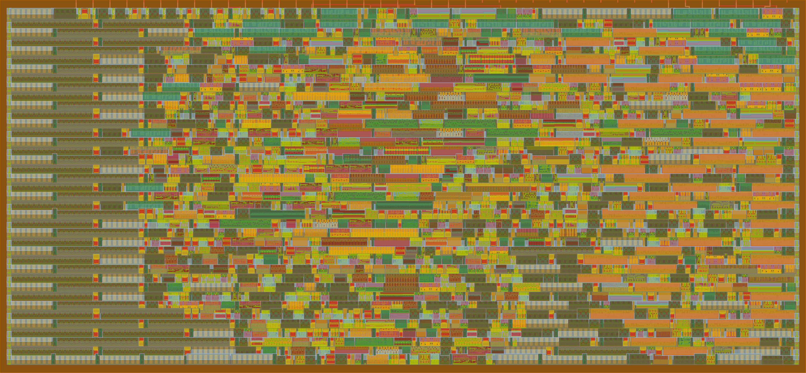

# VGA clock with monochrome stylized segments

___

## Description

An ASIC design that displays a digital clock on a VGA screen, HH:MM format, with stylized 7 segments (custom angular variant of the [_Seamless_](https://michieldb.nl/other/segments/) segment design by Posy (Michiel de Boer)). The monochrome segments make it particularly suited for modded LCD panels, to get black and transparent pixels.

## Tile preview

___

1x1 tile, 47% usage

Navigate through the 3D tile preview [here](https://gds-viewer.tinytapeout.com/?model=https://silkscreen-studio.github.io/Silkscreen-studio-ASIC-VGA-CLOCK/tinytapeout.oas&pdk=gf180mcuD) and watch the GDS 3D simulation [here](https://gds-explorer.tinytapeout.com/viewer?file=https://silkscreen-studio.github.io/Silkscreen-studio-ASIC-VGA-CLOCK/tinytapeout.oas&pdk=gf180mcuD): Enable the VGA monitor to see each line being drawn one after another. For a more accurate simulation (time-wise) try the verilog code on [VGA Playground](https://vga-playground.com) (replace the default code with the [`poject.v`](src/project.v) code in the editor)

## Extended Description

___

This ASIC design displays on a VGA monitor, with a 640x480 resolution, a monochrome digital clock. The time is displayed in the `HH:MM` format (24h) with stylized segmented digits, and can be set using 2 buttons (hold to increment), and an invert pin inverts the display. It either works in standalone mode (time obtained from the `25.175 MHz` core frequency) or with an external `1 Hz` clock (to get more precision with an RTC)

**Internally:** The `px_x` and `px_y` counters in the VGA timing generation for Hsync and Vsync are the screen coordinates the procedural segment construction uses to draw the segments pixel after pixel. The number to display on each digit is decided with the current `HH:MM` values, and the `1 Hz` tick that updates the time is either derived from the `25.175 MHz` core clock or from an edge-detected external clock.

## How to test

___

After hooking up a VGA monitor and the few additional hardware (see below), with the chip running at `25.175 MHz`, the monitor should show `00:00` upon reset. Holding the buttons `H++` (`ui_in[3]`) or `M++` (`ui_in[2]`) increments the hours or minutes every `500 ms`. Release to set the time. Toggling the invert pin (`ui_in[4]`) inverts the B&W image. To run in standalone mode (`1 Hz` tick derived from the `25.175 MHz` clock), the `clock select` pin needs to be set to `LOW` (`ui_in[1]`), and when using an external clock (`clock select` to `HIGH`), a `1 Hz` clock needs to be provided on `ui_in[0]`

## External hardware

___

The VGA pinout is the same as the Tiny VGA PMOD for compatibility, even though only 3 signals are required: `Hsync`, `Vsync` and `BW_out`. Thus `BW_out` is directly outputted on all color channels. 2 buttons and 2 switches for the clock configuration are required too, and a `1 Hz` external clock (from an RTC for example) is optional. 

I'm planning on making a custom PCB that includes everything required to get a clock up and running: mezzanine connector for the COB ASIC, VGA connector with signals attenuated down to 0.7V on each color channel, 25.175 MHz oscillator, buttons, RTC...

